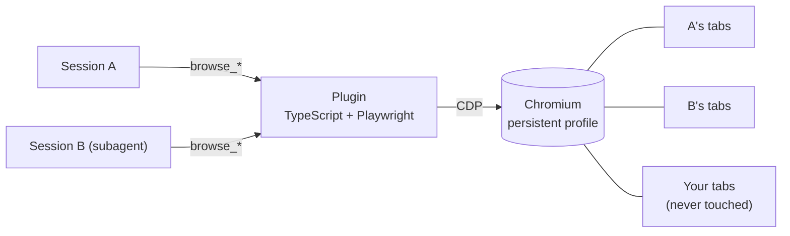

<div align="center">

# opencode-browser

**Give your OpenCode agent a real browser.**
It reads pages cheaply, acts with real mouse and keyboard events, and works next to you
in the same window without getting in your way.

[](https://github.com/Divyanshu-kumar14/opencode-browser/actions/workflows/ci.yml)


[Quickstart](#quickstart) · [Tools](#tools) · [How it works](#how-it-works) · [Configuration](#configuration) · [Security](#security) · [Development](#development)

</div>

---

## Overview

`opencode-browser` is an [OpenCode](https://opencode.ai) plugin that adds thirteen `browse_*` tools.
The agent sees each page as a short numbered list of the things it can act on, plus a screenshot,
and acts by number:

```text
URL: http://127.0.0.1:8787/ — Sign in
## Interactive elements
[1] <input> "Email"
[2] <input value="[redacted]"> "Password"
[3] <button> "Sign in"
[4] <div role="combobox"> "Select Environment"
```

```jsonc
// next call
{ "type": "click", "elementId": 3 }
```

A page costs a few hundred tokens instead of a DOM dump. After every action the list is rebuilt,
so ids always match the page the agent is looking at.

## Features

**Perception**
- Numbered element map in reading order, with occlusion and visibility filtering, open shadow DOM
  and same-origin iframes included.
- Page text as markdown (`browse_read`) for articles, results and docs, in windows for long pages.
- Annotated screenshots, optional per call (`screenshot: false`) or globally.
- Console and network errors since the last call, plus queryable request and console history.

**Action**
- Real input events: click, type, hover, scroll, drag, select, keys, in batches with stale-id recovery.
- Deterministic settling after each action (network quiet, then render quiet).
- Waits for text, selectors, URLs or network idle instead of fixed sleeps.
- File uploads, downloads, and automatic answers to alerts, confirms and prompts.

**Sessions and tabs**
- Each OpenCode session (subagents included) gets its own tabs and runs in parallel with the others.
- Popups belong to the session whose tab opened them.
- Attach to your own Chrome or Brave: the agent opens its own tabs and never touches yours.

**Working alongside you**
- A HUD on the agent's tabs shows the current step, "Thinking…", a cursor and click ripples.
- A **Stop** button interrupts the agent and hands the tab back to you.
- `browse_handoff` asks you to do the steps only you should do, such as signing in, MFA or a CAPTCHA,
  then the agent continues.
- Nothing blocks you: you can click and type in an agent tab at any time.

**Safety**
- Passwords, card numbers and one-time codes are never shown to the agent; URLs lose query strings.
- `browse_eval` asks for permission on every call.
- Optional allow and deny lists for the sites agent tabs may load.
- Uploads only read from the project folder; downloads go to a private folder.

## Quickstart

**Requirements:** Linux x64, [Bun](https://bun.sh) ≥ 1.4.4, Chromium or Chrome, OpenCode with the V2
plugin API.

1. **Add the plugin** to your OpenCode config:

   ```jsonc
   // opencode.jsonc
   { "$schema": "https://opencode.ai/config.json", "plugins": ["opencode-browser"] }
   ```

2. **Start OpenCode and ask for something:**

   ```sh
   opencode run "open https://news.ycombinator.com and list the top five stories"
   ```

   The plugin starts a visible Chromium with a persistent profile on the first browser call and
   reuses it for every call after that.

3. **Optional: use your own browser.** Chrome and Brave 136+ refuse remote debugging on the default
   profile, so start a dedicated automation profile once; the plugin finds it on port 9222:

   ```sh
   scripts/brave-cdp.sh        # Brave on 127.0.0.1:9222 with its own profile
   opencode                    # attaches automatically
   ```

   Any other endpoint: `OPENCODE_BROWSER_CDP_URL=http://127.0.0.1:9333 opencode`.

## Tools

All tools live in the `browse` namespace (`browser` is reserved for OpenCode's built-ins).

| Tool | Use it to | Returns |
|---|---|---|
| `browse_navigate` | go to a URL, back, forward, reload | element map, screenshot, errors |
| `browse_interact` | click, type, hover, scroll, drag, select, press keys, alone or in a batch | element map, screenshot, errors |
| `browse_snapshot` | look at the page again without changing it | element map, screenshot, errors |
| `browse_read` | read what the page says, as markdown, in windows | page text (no screenshot unless asked) |
| `browse_inspect` | debug one element: attributes, box, visibility, computed styles | inspect block, screenshot |
| `browse_wait` | wait for text, a selector, a URL, network idle or a delay | element map, screenshot, what held or timed out |
| `browse_tabs` | list, open, switch and close your own tabs | the active tab's page |
| `browse_viewport` | switch to a desktop / laptop / tablet / mobile size, or back to the window | element map, screenshot |
| `browse_dialog` | choose how the next alert, confirm or prompt is answered | element map, screenshot |
| `browse_upload` | put files into a file input or the picker a button opens | element map, screenshot |
| `browse_network` | list recent requests and console lines | request and console lists |
| `browse_handoff` | hand the tab to the user for sign-in, MFA, a CAPTCHA or a payment | a note to wait for the user |
| `browse_eval` | run JavaScript in the page (asks for permission) | the value, screenshot |

Notes:
- **Screenshots:** any tool that returns the page accepts `screenshot: false` to save tokens.
- **Dialogs:** alerts are accepted and confirms and prompts dismissed by default. Every answer is
  reported, so the page never freezes.
- **Downloads** are saved and reported in the turn that started them, or the next turn if the
  browser starts the download late.
- **Iframes:** same-origin frames appear in the element map marked `(in frame)`. Cross-origin frames
  are listed by origin under "Frames not indexed".
- **Schemas** are written once in zod and published as strict JSON Schema. Unknown fields are
  rejected, and cross-field rules (such as "goto needs a url") fail with `INVALID_INPUT`.
- **`browse_eval` is not a sandbox:** the code runs with the page's privileges.

## How it works



**One browser per OpenCode process.** OpenCode loads plugins many times per server process, so the
browser lives in a process-wide slot and is shared by every plugin instance. A reload with changed
plugin code replaces it, detected by a hash of the source. The browser closes on `SIGINT`,
`SIGTERM` or exit.

**Every tool call is a turn**, run by one shared loop:

```text
session's tab → action → settle → wait for popups → perceive (element map + screenshot)
  → collect errors, dialogs, downloads, blocked loads → format → update the HUD
```

Because the loop lives in one place, every tool gets the same guarantees. The element map is rebuilt
after the turn, and each error is reported exactly once. The HUD never shows a stale step, and a tab
switch is reported once.

**Sessions run in parallel.** One session's turns run one at a time; different sessions run at once,
each in its own tabs, with its own errors, dialog answers and viewport. A popup goes to the session
that owns the tab that opened it.

**The HUD** appears only on the agent's tabs while a session is using the browser. It is hidden in the
agent's screenshots and never appears in its element map. It goes away when every session reports
idle, or after a safety timeout.

<details>
<summary><b>Source layout</b></summary>

| Path | Responsibility |
|---|---|
| `plugin/src/index.ts` | Plugin entry: registers the tools, the idle hook and the Stop interrupter |
| `plugin/src/tools/` | One file per tool: zod schema and the request it sends |
| `plugin/src/core/browser-session.ts` | The turn loop and one intent per request kind |
| `plugin/src/core/session-manager.ts` | Launch or attach, per-session turn queues, browser reset |
| `plugin/src/core/process-browser.ts` | One browser per process, reuse across reloads, signal teardown |
| `plugin/src/core/tab-tracker.ts` | Which session owns which tab; tab-switch notices |
| `plugin/src/core/perception.ts` | Element map, clean screenshot, retry on navigation races |
| `plugin/src/core/presence.ts` | HUD state, safety timer, Stop, hand-off |
| `plugin/src/core/read.ts` · `wait.ts` · `dialogs.ts` · `files.ts` | Page text, waits, dialogs, uploads and downloads |
| `plugin/src/core/site-rules.ts` · `site-guard.ts` | Allow and deny lists and their enforcement |
| `plugin/src/core/telemetry.ts` · `network-log.ts` | Error deltas and request / console history |
| `plugin/src/core/viewport.ts` · `settle.ts` · `action-engine.ts` · `inspect.ts` | Viewport, settling, actions, element inspection |
| `plugin/src/injected/` | In-page element annotator and HUD |
| `plugin/test/` | Unit, property and real-Chromium tests |
| `plugin/legacy/`, `daemon/` | Earlier Rust-daemon design, kept for reference and benchmarks |

Terms used in the code are defined in [`GLOSSARY.md`](GLOSSARY.md).

</details>

## Configuration

Everything is optional; set environment variables before starting OpenCode.

**Browser**

| Variable | Default | Description |
|---|---|---|
| `OPENCODE_BROWSER_HEADLESS` | off | `1` runs headless (CI, servers). No HUD is shown. |
| `OPENCODE_BROWSER_CDP_URL` | unset | Attach to a running browser at this DevTools URL instead of launching one. |
| `OPENCODE_BROWSER_CDP_AUTODETECT` | `1` | With no CDP URL, attach to a browser already listening on `127.0.0.1:9222`. `0` always launches. |
| `OPENCODE_BROWSER_PROFILE_DIR` | `.opencode/browser-profile` | Persistent profile for the launched browser; logins survive restarts. |
| `OPENCODE_BROWSER_EXECUTABLE_PATH` | auto-detected | Chromium or Chrome binary. `CHROME_PATH` also works. |
| `OPENCODE_BROWSER_NO_SANDBOX` | auto (root only) | `1` disables the Chromium sandbox, for containers and CI. |

**Agent presence**

| Variable | Default | Description |
|---|---|---|
| `OPENCODE_BROWSER_INDICATORS` | `1` | Show the HUD and Stop button on the agent's tabs. `0` hides them. |
| `OPENCODE_BROWSER_HUD_TIMEOUT_MS` | `30000` | Hide the HUD this long after the last browser call when OpenCode sends no idle signal (after an interrupt or a failure). |

**Output**

| Variable | Default | Description |
|---|---|---|
| `OPENCODE_BROWSER_SCREENSHOTS` | `1` | Attach a screenshot to every result. `0` returns text only. |
| `OPENCODE_BROWSER_SCREENSHOT_DIR` | `$TMPDIR/opencode/browser-screenshots` | Where screenshots are written (owner-only). |
| `OPENCODE_BROWSER_MAX_ELEMENTS` | `100` | Most elements in one element map. |
| `OPENCODE_BROWSER_MAX_TELEMETRY` | `200` | Most errors kept between calls. |

**Files**

| Variable | Default | Description |
|---|---|---|
| `OPENCODE_BROWSER_UPLOAD_DIR` | the folder OpenCode runs in | Uploads may only read files inside this folder or the download folder; symlinks are resolved first; 50 MB per file. |
| `OPENCODE_BROWSER_DOWNLOAD_DIR` | `$TMPDIR/opencode/browser-downloads` | Where downloads are saved (folder `0700`, files `0600`). |

**Site rules**

| Variable | Default | Description |
|---|---|---|
| `OPENCODE_BROWSER_DENY_ORIGINS` | unset | Comma-separated hosts agent tabs may never load. `example.com` includes subdomains, `*.corp.net` means subdomains only, `host:port` pins a port. |
| `OPENCODE_BROWSER_ALLOW_ORIGINS` | unset | When set, the only hosts agent tabs may load. Deny entries still win. |

Site rules cover every page load in the agent's tabs: `goto`, clicks, redirects and popups. A blocked
load shows a "blocked" page and is reported to the agent. Your own tabs are never filtered. Because the
rules intercept requests, they turn off the HTTP cache for agent tabs, and only while a rule is set.

**Timing and permissions**

| Variable | Default | Description |
|---|---|---|
| `OPENCODE_BROWSER_SETTLE_MAX_TIMEOUT_MS` | `2500` | Longest settle after an action. |
| `OPENCODE_BROWSER_SETTLE_QUIET_WINDOW_MS` | `250` | How long the network must be quiet to count as settled. |
| `OPENCODE_BROWSER_NAVIGATION_TIMEOUT_MS` | `30000` | Navigation timeout. |
| `OPENCODE_BROWSER_EVAL_TIMEOUT_MS` | `30000` | `browse_eval` deadline; a blocking script is terminated. |
| `OPENCODE_BROWSER_EVAL_PROMPT` | `1` | Turn `browser_eval`'s default "allow" into a prompt. `0` leaves it to your permission rules. |
| `OPENCODE_BROWSER_ALLOW_FILE_URLS` | off | `1` lets `browse_navigate` open `file:` URLs. |

## Security

The agent drives a real browser with a real profile, so treat it like a person using your machine.

- **Profiles.** Logins in the launched browser's profile persist. When attaching to your own browser,
  use a dedicated automation profile, never your daily one: any local process can drive a browser
  that listens on a debugging port.
- **Your tabs.** In an attached browser, the agent only lists and acts on tabs it opened. Your tabs'
  dialogs are left for you, and your downloads are not copied.
- **Navigation.** `goto` and new tabs accept only `http:`, `https:` and `about:` URLs (`file:` with
  `OPENCODE_BROWSER_ALLOW_FILE_URLS=1`). Set site rules to filter every load, including redirects.
- **Secrets.** Password, card-number, card-code and one-time-code values never reach the agent. URLs
  in its output lose their query string, fragment and user info.
- **`browse_eval`.** Arbitrary page JavaScript; every call asks for the `browser_eval` permission for
  that page, and refuses to run if the page changed after approval.
- **Files.** Uploads read only from the allowed folders. Downloads are saved under a single safe file
  name in an owner-only folder.
- **Stop button.** Only a real click reaches it; page scripts cannot press it or call it.
- **Page content is data.** Text, dialog messages and console lines come from the web and are
  sanitized before the agent sees them; the agent is told to treat them as data, never instructions.

The full threat model, including what is **not** protected, is in [`docs/security.md`](docs/security.md).

## Development

```sh
cd plugin
bun install
bun run typecheck                          # tsc --noEmit
bun run test                               # unit + real-Chromium e2e (legacy excluded)
OPENCODE_BROWSER_E2E=1 bun run test        # fail instead of skipping when Chromium cannot launch
bun run test:legacy                        # the earlier daemon shim's tests
```

Browser tests launch headless Chromium; set `OPENCODE_BROWSER_EXECUTABLE_PATH` if it is not
detected. The Rust daemon has its own checks:
`cargo test`, `cargo fmt --check` and `cargo clippy` with `--manifest-path daemon/Cargo.toml`.

**CI** runs on every push and pull request:
- Rust checks;
- the engine suite against real Chromium;
- the legacy suite;
- a package check that the tarball stays under 20 MB and its entry imports;
- the daemon's fixture smoke test.

**Packaging.** The published package contains `plugin/src` and this README, with
`@opencode/plugin`, `playwright` and `zod` as dependencies. The daemon and legacy shim are not
shipped.

## Troubleshooting

| Symptom | Fix |
|---|---|
| `chromium did not launch` | Install Chromium or set `OPENCODE_BROWSER_EXECUTABLE_PATH`; try `google-chrome --headless=new about:blank` by hand. |
| The plugin launches its own browser instead of yours | Start yours with `scripts/brave-cdp.sh`, or set `OPENCODE_BROWSER_CDP_URL`. |
| The page does not fill the window | Call `browse_viewport` with no arguments to drop a preset size. |
| Blank or stale element map | Take `browse_snapshot`; check the screenshot and "Frames not indexed". |
| `INVALID_INPUT` | A parameter failed validation (schema, URL, site rule, selector, upload path); the message says which. |
| Stale profile lock after a crash | Close leftover Chromium, then remove `.opencode/browser-profile/SingletonLock`. |
| Browser tests are skipped | Chromium could not launch; set `OPENCODE_BROWSER_E2E=1` to make that a failure. |

## Compatibility and limitations

- **Platform:** Linux x64. The engine is Playwright-based and should port; macOS and Windows are not
  tested yet.
- **Runtime:** Bun ≥ 1.4.4 (the package ships TypeScript). Node ≥ 22 only for the repository scripts.
- **OpenCode:** V2 plugin API (`@opencode/plugin` 2.x). Ending the HUD on idle relies on the
  experimental `experimental.idle` hook; without it the HUD falls back to its timeout.
- **Known limits:**
  - Cross-origin iframes are listed, not indexed; act on them by coordinates.
  - The Stop button and parallel subagents are tested against Chromium, but not yet in a live
    OpenCode session.

## Contributing

Issues and pull requests are welcome. Before opening a pull request:

1. Run `bun run typecheck` and `bun run test` in `plugin/`.
2. Add a test that fails without your change. The suites run against real Chromium, so most
   behaviour can be tested end to end.
3. Use the terms in [`GLOSSARY.md`](GLOSSARY.md) and keep [`docs/security.md`](docs/security.md)
   current when a change touches what the agent can reach.
