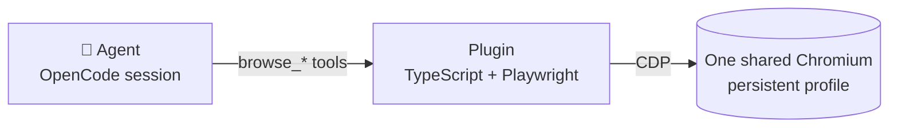

<div align="center">

# 🌐 opencode-browser

**Browser automation for OpenCode, built for agents** — one warm Chromium, token-cheap perception, real mouse and keyboard.

[](https://github.com/Divyanshu-kumar14/opencode-browser/actions/workflows/ci.yml)
[](https://github.com/Divyanshu-kumar14/opencode-browser)
[](https://github.com/Divyanshu-kumar14/opencode-browser)
[](https://github.com/Divyanshu-kumar14/opencode-browser#-tools)

[🚀 Quickstart](#-quickstart) · [🧰 Tools](#-tools) · [🏗 Architecture](#-architecture) · [🛠 Development](#-development)

**Status: v1 on Linux x64.** Six engine tools, a real-Chromium e2e suite, and a quarantined legacy shim. macOS/Windows are post-v1.

</div>

## 👀 At a glance

| 👁 Observe cheaply | 🖱 Act reliably | 🛡 Fail loudly |
|---|---|---|
| Compact `[1..N]` element maps — a page costs hundreds of tokens, not a DOM dump | Auto-wait, occlusion filtering, real input events, stale-id batch recovery | Deterministic settle, typed tool errors, and a CI gate that refuses to pass without Chromium |

## 🏗 Architecture



The plugin owns one browser per OpenCode process. Every tool call is a **turn** through one seam:

```text
ensure active page → intent → settle (mutating turns) → perceive
  → annotated screenshot → telemetry delta → format → attach file → clear HUD
```

Tool handlers map input to a `TurnRequest`; `PlaywrightBrowserSession` executes it and formats
the one payload shape every tool returns. Because the loop lives in one place, the same
guarantees hold for navigate, interact, snapshot, inspect, viewport, and eval:

- the element map is always re-indexed after the turn;
- every screenshot is written once and attached to the result;
- `Settled:` reflects the real settle result;
- console/network deltas are drained exactly once per successful turn (a failed turn leaves
  them for the next response);
- the HUD is cleared on success **and** failure;
- a tab switch is reported on the next response.

**Browser lifetime is process-global, not plugin-instance-global.** OpenCode re-instantiates
plugins many times per server process, so `BrowserSessionManager` lives on `globalThis` under a
`Symbol.for` key. Every plugin instance reuses the same browser, context, and pages; Chromium is
closed only on `SIGINT`/`SIGTERM`/`beforeExit`. Consecutive `browse_*` calls share one tab, one
profile, and one login state.

### Module map

| Path | Responsibility |
|---|---|
| `plugin/src/index.ts` | Plugin entry; registers the six tools against a process-global manager |
| `plugin/src/core/browser-session.ts` | The turn seam: Playwright adapter and the one closed loop |
| `plugin/src/core/session-manager.ts` | Browser/context/tab lifetime, viewport sync, teardown |
| `plugin/src/core/turn.ts` | `TurnRequest`, `TurnOutcome`, and the single result formatter |
| `plugin/src/core/action-engine.ts` | Action batches, stale-id recovery, perception capture, HUD helpers |
| `plugin/src/core/settle.ts` | Deterministic post-action settling |
| `plugin/src/core/telemetry.ts` | Bounded ring buffer + delta cursor for console/network errors |
| `plugin/src/core/inspect.ts` | Element diagnostics probe |
| `plugin/src/core/viewport.ts` | Pure preset/fit/drift math |
| `plugin/src/injected/` | Set-of-Mark annotator and live HUD scripts |
| `plugin/src/tools/` | Six thin handlers: zod schema + `TurnRequest` mapping |
| `plugin/src/tools/index.ts` | `defineTool` registry; JSON Schema derived from zod |
| `plugin/legacy/` | Quarantined Rust-daemon shim (not registered, tested separately) |

## 🚀 Quickstart

```jsonc
// opencode.jsonc
{ "$schema": "https://opencode.ai/config.json", "plugins": ["opencode-browser"] }
```

```sh
opencode run "navigate to http://127.0.0.1:8787, snapshot, and tell me what you see"
```

What the agent sees:

```text
URL: http://127.0.0.1:8787/ — Sign in
[1] <input> "Email" (#email)
[2] <button> "Sign in"
[3] <div> "Select Environment" role=combobox
```

Then it acts by id: `browse_interact { "type": "click", "elementId": 2 }`. Ids are assigned in
reading order on every turn, so after any mutation the next result carries a fresh map.

## 🧰 Tools

Six tools, all `codemode: true`, under the `browse` namespace (the host reserves `browser` for
its built-in tools).

| Tool | What it does | Returns |
|---|---|---|
| `browse_navigate` | goto / back / forward / reload, then settle + perceive | element map + screenshot + telemetry |
| `browse_interact` | single action or batched `actions[]` (click, type, hover, scroll, press_key, select_option, drag, wait) by `elementId`, selector, or coordinates | element map + screenshot + telemetry |
| `browse_snapshot` | re-index + fresh screenshot without mutating | element map + screenshot + telemetry |
| `browse_inspect` | tag, attributes, bbox, visibility, computed styles for one element | inspect block + screenshot + telemetry |
| `browse_viewport` | desktop/laptop/tablet/mobile preset, custom size, or bare resync | element map + screenshot + telemetry |
| `browse_eval` | JavaScript in the page context (localStorage, globals, React state) | serialized value + screenshot + telemetry |

`browse_eval` is **not a sandbox**: the expression runs with the page's privileges. Treat it as
you would DevTools.

### Input schemas

Schemas are written once in zod and converted to JSON Schema at registration, so types, enums,
defaults, array bounds, and strictness cannot drift. Cross-field rules (for example "goto needs a
url" or "drag needs toX/toY") are zod refinements: they are enforced at runtime with
`code: "INVALID_INPUT"`, but JSON Schema cannot express them, so they do not appear in the
advertised schema. Objects are strict, so unknown fields are rejected rather than silently
dropped.

## ⚙️ Configuration

All options are optional; defaults shown.

| Variable | Default | Notes |
|---|---|---|
| `OPENCODE_BROWSER_HEADLESS` | unset (headful) | `1`/`true` for headless (CI, servers) |
| `OPENCODE_BROWSER_CDP_URL` | unset (persistent launch) | e.g. `http://127.0.0.1:9222` — attach to a running Chrome instead of launching |
| `OPENCODE_BROWSER_PROFILE_DIR` | `.opencode/browser-profile` | persistent profile; cookies/localStorage survive runs |
| `OPENCODE_BROWSER_EXECUTABLE_PATH` | auto-detected (`/usr/bin/chromium`, `google-chrome`, …) or `CHROME_PATH` | override when Playwright has no bundled browser |
| `OPENCODE_BROWSER_SCREENSHOT_DIR` | `$TMPDIR/opencode/browser-screenshots` | annotated PNG output |
| `OPENCODE_BROWSER_MAX_ELEMENTS` | `100` | SoM index cap |
| `OPENCODE_BROWSER_MAX_TELEMETRY` | `200` | telemetry ring-buffer bound |
| `OPENCODE_BROWSER_SETTLE_MAX_TIMEOUT_MS` | `2500` | settle hard deadline |
| `OPENCODE_BROWSER_SETTLE_QUIET_WINDOW_MS` | `250` | network quiet window |
| `OPENCODE_BROWSER_NAVIGATION_TIMEOUT_MS` | `30000` | `goto` timeout |
| `OPENCODE_BROWSER_NO_SANDBOX` | unset (auto for root) | `1` only where Chromium cannot sandbox (containers, CI) |

Attach to an existing Chrome:

```sh
chromium --remote-debugging-port=9222
OPENCODE_BROWSER_CDP_URL=http://127.0.0.1:9222 opencode
```

## 🔒 Security

- **Profile:** a persistent Chromium profile under `.opencode/browser-profile` is reused across
  runs. Anything you log into stays logged in until that directory is removed.
- **Screenshots:** annotated PNGs are written to `$TMPDIR/opencode/browser-screenshots` (temporary;
  cleared on reboot) and attached to
  tool results; they stay on disk.
- **Eval:** arbitrary page-context JavaScript, with the page's privileges. It is not a sandbox
  and is not permission-gated.
- **Sandbox:** Chromium sandboxing stays on unless `OPENCODE_BROWSER_NO_SANDBOX=1` or the
  process runs as root, where the sandbox cannot work.
- **Page content** can still attack the browser itself (standard CDP caveat).

## 🛠 Development

```sh
# Engine: unit + registry + real-Chromium e2e (Chromium required for e2e)
cd plugin && bun install
cd plugin && ./node_modules/.bin/tsc --noEmit
cd plugin && bun run test                 # legacy files excluded

# Fail instead of skipping when Chromium cannot launch
cd plugin && OPENCODE_BROWSER_E2E=1 bun test test/e2e.test.ts

# Quarantined shim (Rust-daemon RPC): still green, never part of the default run
cd plugin && bun run test:legacy

# Daemon (kept in-repo as an experimental baseline)
cargo test --manifest-path daemon/Cargo.toml
cargo fmt --check --manifest-path daemon/Cargo.toml
cargo clippy --manifest-path daemon/Cargo.toml --all-targets -- -D warnings
node scripts/smoke.mjs                    # daemon smoke against the fixture
```

CI runs five jobs: Rust checks, the engine suite (with `OPENCODE_BROWSER_E2E=1`), the quarantined
legacy suite, a pack-content/size smoke that installs and imports the packed entry, and the daemon
fixture smoke. A browser test that cannot launch fails the engine job instead of reporting green.

## 📦 Packaging

The published package ships `plugin/src` plus this README and declares `@opencode/plugin`,
`playwright`, and `zod` as dependencies. The Rust daemon and the legacy shim are **not** shipped.
Tarball size budget: ≤20 MB compressed, enforced by CI.

## 🧪 Legacy shim and daemon

The earlier design used a TypeScript shim speaking NDJSON to a Rust CDP daemon (`browserd`). The
plugin no longer registers it. Both live in-tree for reference and benchmarking:

- `plugin/legacy/src/` — shim, RPC client, supervisor, raw-CDP JS driver;
- `plugin/legacy/test/` — its 80 tests (run with `bun run test:legacy`);
- `daemon/` — Rust daemon with its own unit tests and fixture smoke suite.

`node scripts/bench.mjs --driver js` measures that baseline; `--mock` needs no Chrome.

## ⚠️ Troubleshooting

| Symptom | Fix |
|---|---|
| `chromium did not launch` | Install Chromium or set `OPENCODE_BROWSER_EXECUTABLE_PATH`; run `google-chrome --headless=new about:blank` by hand |
| In CI, tests skip instead of failing | Set `OPENCODE_BROWSER_E2E=1` |
| Blank or stale element map | The page may be cross-origin or empty; take `browse_snapshot` and check the screenshot |
| `INVALID_INPUT` | A parameter failed the advertised zod schema — read the message and retry |
| Screenshot missing from the result | Check `OPENCODE_BROWSER_SCREENSHOT_DIR` is writable |
| Chromium leaves a stale profile lock | Kill leftover Chromium, then remove `.opencode/browser-profile/SingletonLock` |

## ✅ Compatibility

- OS/CPU: Linux x64 for v1; the engine itself is Playwright-based and portable.
- Runtimes: Bun ≥1.4.4 for the plugin and its tests (the package exports TypeScript). Node ≥22
  is only needed for the repository scripts (`smoke.mjs`, `bench.mjs`, `build-native.mjs`).
- OpenCode: V2 plugin API (`@opencode/plugin` 2.x).
