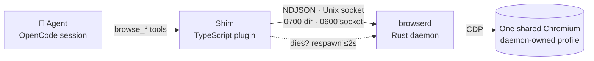
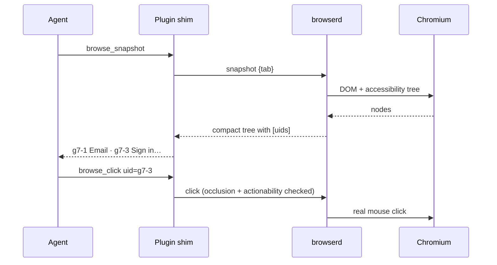

<div align="center">

# 🌐 opencode-browser

**Browser automation for OpenCode, built for agents** — one warm Chromium, token-cheap snapshots, safety by construction.

[](https://github.com/Divyanshu-kumar14/opencode-browser/actions/workflows/ci.yml)
[](https://github.com/Divyanshu-kumar14/opencode-browser)
[](https://github.com/Divyanshu-kumar14/opencode-browser)
[](https://github.com/Divyanshu-kumar14/opencode-browser#--tools)

[🚀 Quickstart](#-quickstart) · [🧰 Tools](#-tools) · [🔒 Security](#-security) · [🛠 Development](#-development)

**Status: v1 on Linux x64.** Full tool surface implemented, 61-check smoke suite green, CI green. macOS/Windows are post-v1.

</div>

## 👀 At a glance

<div align="center">

| 👁 Observe cheaply | 🖱 Act reliably | 🛡 Stay safe |
|---|---|---|
| Compact snapshots with stable `[uid]` refs — pages cost hundreds of tokens, not DOM dumps | Auto-wait, occlusion checks, exactly-once stale-uid retry, typed timeouts | Session-owned tabs, permission-gated eval/upload, secrets redacted at capture |

</div>

## 🏗 How it works



The shim translates tool calls into daemon RPCs. The daemon owns exactly one Chromium, multiplexes session tabs onto it (max 8, LRU, 10-minute leases), and survives OpenCode restarts.

A typical round-trip:



## 🚀 Quickstart

```jsonc
// opencode.jsonc
{ "$schema": "https://opencode.ai/config.json", "plugins": ["opencode-browser"] }
```

```sh
opencode run "navigate to http://127.0.0.1:8787, snapshot, and tell me what you see"
```

What the agent sees:

```text
page http://127.0.0.1:8787 (g7)
  textbox "Email" [g7-1]
  button "Sign in" [g7-3]
```

…and clicks `g7-3` with a real mouse event. Uids encode the page generation, so a stale uid fails safe (`UID_STALE`) instead of clicking the wrong node.

## ⚙️ Configuration

All options are optional; defaults shown.

| Option | Values | Default | Notes |
|---|---|---|---|
| `driver` | `"rust"` \| `"js"` | `"rust"` | `"js"` is an in-process raw-CDP baseline (also the daemon fallback); needs no binary |
| `mode` | `"launch"` \| `"attach"` | `"launch"` | `attach` connects to an existing debug-enabled Chrome; opt-in, never closes your tabs |
| `attach_url` | URL | `http://127.0.0.1:9222` | only used in `attach` mode |
| `profile` | `"fresh"` \| `"persistent"` \| `"<path>"` | `"fresh"` | `persistent` reuses cookies across runs (still isolated from your real Chrome) |
| `max_tabs` | 1–32 | `8` | hard cap; LRU evicts unowned/idle tabs first, never an actively-owned tab |
| `idle_timeout_s` | seconds | `1800` | daemon exits after 30 min with zero tabs |

## 🧰 Tools

<div align="center">

20 tools · all `codemode: true` · `browse_` prefix (the host reserves `browser` for its built-in tools, where a colliding id is silently dropped)

</div>

| Tool | What it does | Returns |
|---|---|---|
| `browse_navigate` | go to a URL in your session tab | `{tab_id, url, title, status}` |
| `browse_snapshot` | compact accessibility snapshot with `[uid]` refs | text tree, `max_nodes` default 300 |
| `browse_click` | real mouse click at the element center (occlusion-checked, auto-waits) | `{ok}` |
| `browse_fill` | focus + real key events (works with React/Vue) | `{ok}` |
| `browse_hover` | move the mouse over a uid (menu/hover states) | `{ok, x, y}` |
| `browse_select` | pick a `<select>` option by value, label or index | `{value, label, index}` |
| `browse_upload` | attach local files to a file input (**permission-gated**) | `{files}` |
| `browse_dialog` | accept/dismiss a JS dialog (after `dialog_policy: manual`) | `{action, dialog}` |
| `browse_scroll` | scroll up/down/left/right/top/bottom | `{scrollX, scrollY, at_bottom}` |
| `browse_press_key` | key press, optionally into a uid | `{ok}` |
| `browse_eval` | run JS in the page (**permission-gated**, see below) | `{value}` |
| `browse_screenshot` | PNG capture | file attachment + `{path}` |
| `browse_console` | recent console messages (ring buffer, 500/tab) | `{messages, next_since}` |
| `browse_network` | recent requests (ring buffer, 500/tab) | `{requests, next_since}` |
| `browse_network_body` | one response body by `request_id` | `{body, bytes, truncated}` |
| `browse_route` | mock a URL pattern: fulfill with a fixture or abort it | `{pattern, action, routes}` |
| `browse_wait_for_uid` | wait for a `[uid]` to appear (bounded poll) | `{found, elapsed_ms}` or `NAV_TIMEOUT` |
| `browse_expect_text` | wait for a page-text substring (bounded poll, plain match) | `{matched, elapsed_ms}` or `NAV_TIMEOUT` |
| `browse_list_tabs` / `browse_close_tab` | inspect / close tabs (yours only) | `{tabs}` / `{closed}` |

**📜 Logs without gaps.** `browse_console` / `browse_network` accept `since` (the previous response's `next_since`) and return only newer entries, so polling loops can't skip rows. Headers are included only with `include_headers: true` (already redacted). Bodies default to 16 KiB (cap 256 KiB) and report `BODY_UNAVAILABLE` once Chrome evicts them.

**🎭 Deterministic mocks.** `browse_route` binds one literal URL pattern (`substring`, `prefix`, or bare `host`) to `fulfill` or `abort` on your session tab. Patterns are capped at 512 chars and matched literally — never a regex. Fulfilled mocks answer with exactly one header (`content-type`); secrets are never reflected. Mocks die with the tab; unmatched requests pass through untouched.

**⏳ Bounded waits.** Both wait tools poll every 150 ms (`timeout_ms` default 5 s, clamp 100 ms–30 s) without holding the per-tab lock, so a long wait can't wedge the tab. Success reports elapsed time; a blown deadline is a typed `NAV_TIMEOUT`.

**🪪 Identity rules.** Stale uids fail safe (`UID_STALE`) — and the shim retries once automatically (re-snapshot, re-resolve by role+name, retry exactly once). Other sessions' tabs answer `TAB_FORBIDDEN`. `browse_eval` is gated per page (`action: "browser_eval"`, UI prompt, no hook bypass); `browse_upload` the same with file paths as resources. Dialogs auto-dismiss by default (`dialog_policy: "auto"`); pass `"manual"` + `browse_dialog` to drive one.

## 🔒 Security (summary)

- **Socket:** `$XDG_RUNTIME_DIR/opencode-browser/v1/` (`0700`), `daemon.sock` (`0600`), `SO_PEERCRED` uid check — another local user cannot connect.
- **Navigation allowlist:** `http`, `https`, `about`; `file:` only with explicit opt-in; `javascript:` rejected, re-checked after redirects.
- **Eval:** permission-gated per session; attach mode is opt-in and tags only daemon-owned targets.
- **Upload:** permission-gated; the daemon re-validates every path (absolute, regular file, no `..`, no symlinks, ≤8 files / 100 MiB).
- **Logs:** query strings/fragments redacted; credential-bearing headers redacted at capture; upload errors name basenames only.
- **Not protected:** a page you navigate to can still attack the browser itself (standard CDP caveat); web content is not sandboxed.

Full notes: [`docs/security.md`](docs/security.md), [`docs/IMPLEMENTATION-PLAN.md`](docs/IMPLEMENTATION-PLAN.md).

## 🛠 Development

```sh
cargo test --manifest-path daemon/Cargo.toml   # Rust unit tests
cargo fmt --check --manifest-path daemon/Cargo.toml
cargo clippy --manifest-path daemon/Cargo.toml --all-targets -- -D warnings
cd plugin && ./node_modules/.bin/tsc --noEmit && bun test   # shim
node scripts/smoke.mjs                          # 61-check end-to-end vs real Chrome
```

CI runs all of the above plus a pack-size budget and the smoke suite as e2e. The merge bar is green trio + 61/61 smoke; performance claims require same-conditions before/after numbers, never estimates.

## 📊 Benchmarks

Baselines on the same machine/Chrome/fixture: **A** = raw-CDP JS driver in-process, **B** = Rust daemon. Workload: 1/4/8 sessions × 20 calls, 3 runs. Metrics: cold first call, warm p50/p95 per method, idle/marginal/total-tree RSS, collisions.

> **Pre-registered kill rule:** if Rust shows **<20% improvement** in marginal memory per session **and** **<20%** in warm-call p95 vs baseline A, the daemon does **not** become the default — the JS driver ships instead.

Run it: `node scripts/bench.mjs --mock` (no Chrome) or `node scripts/bench.mjs --driver js` (real Chrome); `--compare <other-results.json>` evaluates the rule. Decision memo: [`bench/results/report.md`](bench/results/report.md).

## 📦 Packaging

`node scripts/build-native.mjs` builds `browserd --release`, strips it, and stages `prebuilds/linux-x64/browserd` (`755`). The npm tarball ships `plugin/ + prebuilds/ + README.md` **inside** the package (no postinstall download for v1). **Size budget: ≤20 MB compressed**, enforced by CI.

## 🆘 Troubleshooting

| Symptom | Fix |
|---|---|
| `DAEMON_UNAVAILABLE` / empty reply | Is it running? `ss -x \| grep opencode-browser`. If dead, the shim respawns it on next call (≤2 s backoff) |
| `PROTOCOL_MISMATCH` | Shim/daemon version skew. The socket path embeds the protocol major (`.../v1/`), so kill the stale daemon (below) and retry |
| `CHROME_DEAD` | Chrome crashed; the daemon relaunches once automatically — just retry. Persistent? Run `google-chrome --headless=new about:blank` by hand |
| `UID_STALE` / `UID_NOT_FOUND` | Page changed since the snapshot. The shim already retried once; re-run `browse_snapshot` and use the new uids |
| `NAV_TIMEOUT` | Condition not met within budget. Retry with a larger `timeout_ms`, or snapshot what rendered |
| `TAB_FORBIDDEN` | That tab belongs to another session. Navigate in your own session instead |
| Need the socket path | `${XDG_RUNTIME_DIR:-/tmp/opencode-browser-$UID}/opencode-browser/v1/daemon.sock` (see `daemon/src/paths.rs`) |
| Kill the daemon | `pkill -x browserd`, or send `{"id":1,"method":"shutdown","params":{}}` on the socket. Tabs die with it; Chrome's profile dir is removed |

## ✅ Compatibility

- OS/CPU: `linux` / `x64` (v1). macOS/Windows are post-v1.
- Runtimes: Node ≥22 or Bun ≥1 (shim + bench scripts).
- OpenCode: V2 plugin API (`@opencode/plugin` 2.x).
- Protocol: major version in the socket path (`v1/`); mismatched shims refuse to talk to old daemons instead of misbehaving.
